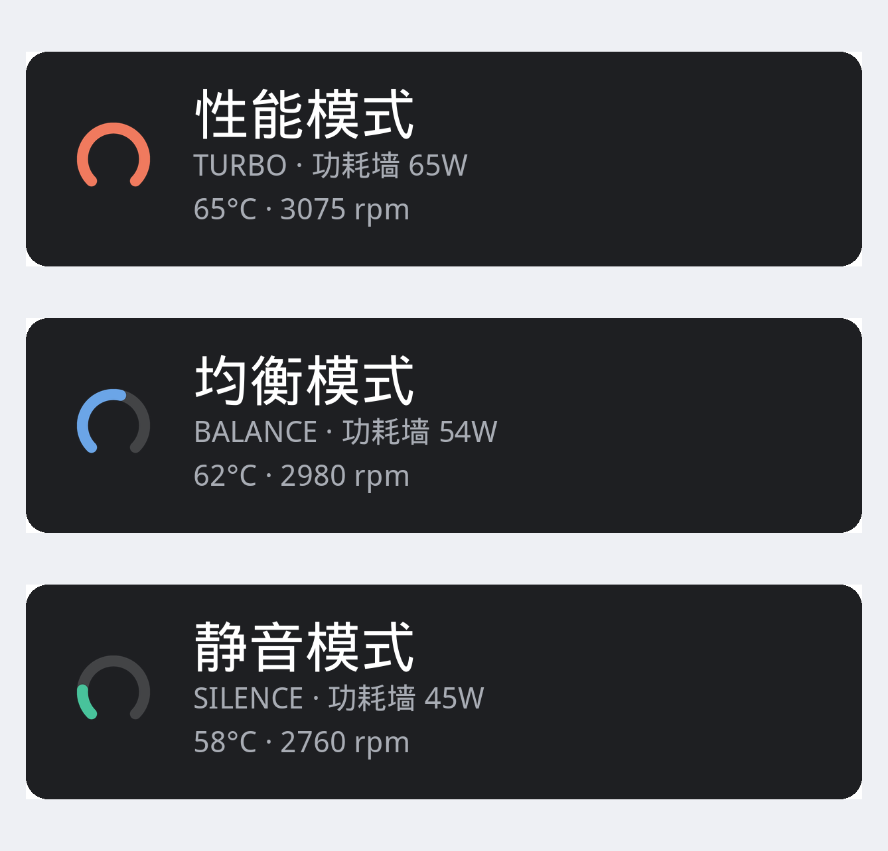

# perfmode

机械革命 无界14 Pro（MECHREVO WUJIE14 PRO）的 Windows 性能模式切换工具。

一个 exe，不装驱动、不用界面，直接读写 EC（嵌入式控制器）里的性能模式字段，
在 **性能 / 均衡 / 静音** 三档之间切换，并提供一个替代原厂 OSD 的后台提示程序。



## 特性

- **三档切换**：性能 65W / 均衡 54W / 静音 45W，写 EC 后立即生效
- **后台 OSD**：按 `Fn+F1` 或命令行切换时，屏幕上方弹出提示（图标 + 模式 + 功耗墙）
- **托盘菜单**：直接切模式、调键盘背光、开关温度显示、开机自启
- **传感器**：9 路温度、双风扇转速
- **键盘背光**：关 / 暗 / 亮
- 单文件、零依赖、**不需要管理员权限**

## 支持的机型

| 机型 | 状态 |
|------|------|
| 机械革命 无界14 Pro（MECHREVO WUJIE14 PRO） | 已在实机验证 |

其他同方/机械革命机型请先跑 `perfmode probe`，再用 `perfmode calibrate` 重新校准 EC 偏移。

## 原理

这台机器的三档模式由 EC RAM 里的一个字节 `ITSM` 决定：

| 模式 | ITSM 值 | 功耗墙（来自 DSDT 的 THMP 热表） |
|------|---------|----------------------------------|
| turbo（性能） | 0 | 65W / 54W |
| balance（均衡） | 1 | 54W / 50W |
| silence（静音） | 2 | 45W / 25W |

- `ITSM` 位于 **EC RAM 偏移 `0xE4`**，由 DSDT 的 `OperationRegion` 字段布局推得
- 按 `Fn+F1` 时固件在 `_Q01` 里执行 `ECWT(...)` 改这个字节，并 `Notify(WMID, 0x20)` 让原厂 OSD 弹提示
- 本工具直接写同一个字节，效果等价；读写通过 x86 I/O 端口 `0x62`/`0x66` 完成，
  复用系统里已有的 `inpoutx64.sys`（InpOut v1.2）

为什么不用 ACPI：Windows 不向用户态暴露 `PNP0C09`/`PNP0C14` 的设备接口，`\\.\ACPI` 也不存在，
`IOCTL_ACPI_EVAL_METHOD*` 拿不到句柄；固件也没提供 BMOF，`root\WMI` 里没有可用的 ACPI-WMI 类。
完整论证见 [DESIGN.md](DESIGN.md)。

## 依赖

只需要系统里已经加载 `inpoutx64.sys`。多数装过硬件监控 / 风扇控制类软件
（MSI Afterburner、LibreHardwareMonitor、部分游戏本控制中心）的机器都有。

```cmd
sc query inpoutx64
```

没有的话从 <http://www.highrez.co.uk/downloads/inpout32/> 获取并安装。

## 使用

```cmd
perfmode status                  :: 当前模式
perfmode turbo                   :: 性能模式
perfmode balance                 :: 均衡模式
perfmode silence                 :: 静音模式
perfmode set <模式>               :: 按名字设置
perfmode list                    :: 列出模式与原始值
perfmode watch [毫秒]             :: 监视模式变化
perfmode ec                      :: 打印温度 / 风扇转速等传感器
perfmode backlight [0|1|2]       :: 查看或设置键盘背光
perfmode osd                     :: 启动后台提示程序
perfmode osd-stop                :: 结束后台提示程序
perfmode autostart on|off|status :: 开机自启
perfmode probe                   :: 诊断
perfmode calibrate               :: 重新校准 EC 偏移
perfmode offset <hex>            :: 手动指定 EC 偏移
```

命令别名：`status`=`s`/`get`，`turbo`=`t`/`performance`，
`balance`=`b`/`balanced`/`normal`，`silence`=`silent`/`quiet`/`powersave`。

### 后台提示程序

```cmd
perfmode osd
```

启动后没有窗口，只在托盘留一个图标（Windows 11 默认收进溢出区，拖出来一次即可固定）。
之后无论是命令行切换还是按 `Fn+F1`，屏幕上方都会弹出提示（见顶部配图）：
左侧是按模式变化的仪表图标，右侧是模式名、功耗墙，以及可选的温度与转速。

托盘右键菜单：性能/均衡/静音、背光 关/暗/亮、弹窗附带温度转速、显示当前模式、开机自启、退出。
悬停提示实时显示 `perfmode — 均衡模式 · 66°C · 3080 rpm`。

参数：`--interval 毫秒`（轮询间隔，默认 300）、`--stay 毫秒`（停留时长，默认 1800）。

## 可调参数

| 参数 | 能否调整 | 说明 |
|------|---------|------|
| 性能模式 | ✅ 读写 | `EC[0xE4]` ITSM，0/1/2 |
| 键盘背光 | ✅ 读写 | `EC[0xE2]` KBBL，0/1/2 |
| 温度 / 风扇转速 | 只读 | 用于显示 |
| 风扇转速控制 | ❌ | 固件没有占空比寄存器，风扇曲线由 `THMD()` 经 BIOS SMI 写热表，用户态无法调用 |
| 充电阈值 | ❌ | 固件未暴露 |

## 配置文件

`%APPDATA%\mechrevo-perfmode\config.json`：

```json
{
  "mapping": { "turbo": 0, "balance": 1, "silence": 2 },
  "ec_offset": 228,
  "osd": { "interval_ms": 300, "stay_ms": 1800, "show_sensors": true }
}
```

- `ec_offset`：`ITSM` 的偏移（228 = 0xE4）
- `mapping`：逻辑模式到固件值的映射，档位对不上时改这里，无需重编译
- `osd`：后台程序的设置，托盘菜单里的开关也会写回这里

## 构建

```bash
GOOS=windows GOARCH=amd64 CGO_ENABLED=0 go build -ldflags="-s -w" -o perfmode.exe .
```

或 `make build` / `make vet` / `make clean`。

exe 的图标来自 `rsrc_windows_amd64.syso`，由 [go-winres](https://github.com/tc-hib/go-winres) 生成：

```bash
go install github.com/tc-hib/go-winres@latest
go-winres simply --icon osd/assets/app.ico --product-name perfmode \
  --product-version 2.0.0 --file-version 2.0.0
```

图标设计稿由 `design/gen_icons.py` 生成，运行期资源由 `design/build_assets.py` 写入 `osd/assets/`。

## 项目结构

```
perfmode/
├── main.go                入口
├── cmd/
│   ├── root.go            子命令分发
│   ├── osd.go             后台提示程序
│   └── extra.go           背光、开机自启
├── core/
│   ├── mode.go            模式枚举、映射、配置
│   ├── backend.go         后端抽象与自动探测
│   ├── ecdirect.go        EC 读写时序（0x62/0x66 握手）
│   ├── portio.go          inpoutx64 端口 I/O
│   ├── ecfields.go        已知 EC 字段与传感器
│   ├── backlight.go       键盘背光
│   ├── mifs.go            ACPI-WMI（其他同方机型备用）
│   ├── acpi.go            ACPI IOCTL 封装（当前机型不可用，保留）
│   └── probe.go           诊断
├── osd/
│   ├── osd_windows.go     分层窗口 + 绘制
│   ├── tray_windows.go    托盘图标与菜单
│   ├── draw_windows.go    GDI AlphaBlend 贴图
│   ├── assets.go          图标资源嵌入
│   └── assets/            PNG / ICO
├── design/                图标设计脚本与预览
├── DESIGN.md              实现说明与逆向过程
└── Makefile
```

## 常见问题

**Q: `打开 \\.\inpoutx64 失败`**
A: 系统里没有加载 InpOut 驱动。用 `sc query inpoutx64` 确认，没有就按上面的链接安装。

**Q: 按 Fn+F1 后 OSD 不弹**
A: 确认 `perfmode osd` 在运行；模式变化需要连续两次读到同一新值才弹窗（去抖），
所以快速连按可能只弹一次。

**Q: 读到的模式一直不变**
A: EC 偏移不对。跑 `perfmode calibrate` 重新定位。

**Q: 切换后风扇/功耗没变化**
A: 先看 `perfmode status` 的原始值有没有变。变了但体感没变，可能是 `mapping` 与固件不符。

**Q: 会不会伤机器**
A: 只写 `0xE4` / `0xE2` 这两个字节，都是固件自己也会写的目标，不碰其他寄存器。
但仍建议不要在刷 BIOS 等敏感操作时运行。

## 参考

- 内核模块（ACPI 路径与模式枚举）：<https://github.com/wlmqljj/mechrevo-wujie14pro-perfmode-kmod>
- 同模具 WMI/EC 分析：<https://github.com/MintyMods/ip3-power-switch>
- InpOut32 驱动：<http://www.highrez.co.uk/downloads/inpout32/>
- 图标规范：<https://learn.microsoft.com/en-us/windows/apps/design/style/iconography/app-icon-design>

## 图标

图标按 Windows 11 应用图标规范设计：满铺圆角色块 + 白色字形，环的填充比例表示档位
（静音 18% / 均衡 55% / 性能 100%），托盘图标为单色并跟随系统深浅色主题。

设计稿见 [design/out/preview.png](design/out/preview.png)，由 `design/gen_icons.py` 生成；
运行期资源由 `design/build_assets.py` 写入 `osd/assets/`。

## 许可证

[GPL-3.0](LICENSE)
